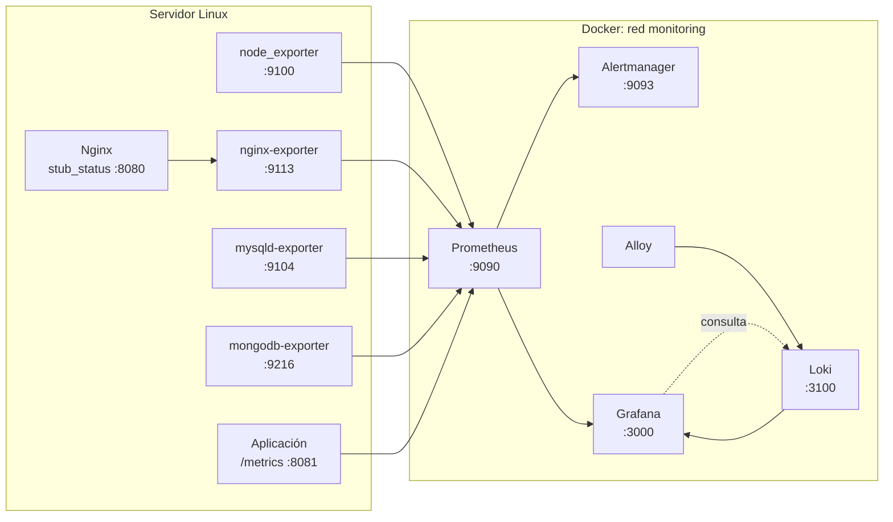

# Monitoreo profesional con Prometheus y Grafana

Guía reproducible para desplegar un sistema de observabilidad completo sobre un servidor Linux: métricas de sistema, servicios y aplicación con **Prometheus**, visualización y autenticación con **Grafana**, alertas con **Alertmanager**, logs con **Loki + Alloy** y descubrimiento automático de objetivos.

> **Alcance de este repositorio:** es una guía de implementación. No contiene código de aplicación ni archivos de configuración en el repositorio; todos los bloques se copian en el servidor siguiendo el orden del documento.


**Versiones verificadas:** 29 de octubre de 2026. Fija siempre versiones concretas; no uses `latest` en producción.

---

## Tabla de contenido

1. [Resumen y arquitectura](#1-resumen-y-arquitectura)
2. [Requisitos y decisiones de diseño](#2-requisitos-y-decisiones-de-diseño)
3. [Preparación del servidor](#3-preparación-del-servidor)
4. [Estructura del proyecto](#4-estructura-del-proyecto)
5. [Stack con Docker Compose](#5-stack-con-docker-compose)
6. [Configuración de Prometheus](#6-configuración-de-prometheus)
7. [Exporters e instrumentación](#7-exporters-e-instrumentación)
8. [Grafana: datasource, dashboards y acceso](#8-grafana-datasource-dashboards-y-acceso)
9. [PromQL y recording rules](#9-promql-y-recording-rules)
10. [Alertas y Alertmanager](#10-alertas-y-alertmanager)
11. [Logs con Loki y Alloy](#11-logs-con-loki-y-alloy)
12. [Service discovery](#12-service-discovery)
13. [Operación, backup y troubleshooting](#13-operación-backup-y-troubleshooting)
14. [Seguridad](#14-seguridad)
15. [Entrega del reto](#15-entrega-del-reto)
16. [Roadmap, licencia y referencias](#16-roadmap-licencia-y-referencias)

---

## 1. Resumen y arquitectura

El objetivo es responder cuatro preguntas en todo momento:

| Pregunta | Señal | Herramienta |
| --- | --- | --- |
| ¿Está vivo el servidor? | `up`, CPU, memoria, disco, red | Prometheus + node_exporter |
| ¿Están sanos Nginx, MySQL y MongoDB? | Métricas de servicio | Exporters oficiales |
| ¿Cómo se comporta mi aplicación? | RED: rate, errors, duration | Instrumentación `/metrics` |
| ¿Qué está pasando cuando algo falla? | Logs correlacionados | Loki + Alloy + Grafana |



**Flujo de datos**

1. Cada exporter publica métricas en formato de texto Prometheus en `/metrics`.
2. Prometheus hace *scrape* periódicamente, las almacena en su TSDB local y evalúa reglas.
3. Grafana consulta Prometheus por HTTP y Loki para los logs.
4. Alertmanager recibe las alertas de Prometheus y las enruta a email/Slack.
5. Alloy descubre los contenedores y envía sus logs a Loki.

**Resultado esperado:** un stack reproducible, con persistencia, alertas, dashboards versionados y acceso autenticado.

---

## 2. Requisitos y decisiones de diseño

### 2.1 Requisitos

- Servidor Linux (Ubuntu 22.04/24.04 LTS o Debian 12+) con acceso `sudo`. Si partes de cero, un Droplet de DigitalOcean o una instancia EC2 con Ubuntu LTS es suficiente.
- 2 vCPU, 4 GB de RAM y 40 GB de disco como mínimo para el stack completo.
- Docker Engine 24+ en modo rootful y Docker Compose v2 (los exporters necesitan host PID/network).
- Aplicación con dependencias reales: Nginx, Node.js, MySQL o MongoDB.
- Dominio y DNS solo si vas a exponer Grafana por HTTPS.
- Puertos de salida permitidos para descargar imágenes y enviar alertas.

> **Ojo con el disco:** Prometheus y Loki crecen con el tiempo. Un disco pequeño se llena antes de lo que parece. La retención se configura en la sección 6 y se calcula en la 13.

### 2.2 Decisiones que no conviene cambiar a mitad del proyecto

| Decisión | Elección | Motivo |
| --- | --- | --- |
| Orquestación | Docker Compose v2 | Reproducible, portable y suficiente para un servidor único |
| Métricas | Prometheus | Pull model, PromQL y ecosistema de exporters |
| Logs | Loki + Alloy | Ligero y correlacionable con métricas desde Grafana |
| Puerto de Grafana | `127.0.0.1:3000` | Evita exponer la UI sin TLS |
| Versiones | Tags exactos | Evita sorpresas al reiniciar |
| Secretos | Variables de entorno + Docker secrets | Nada sensible en Git |

### 2.3 Convención de nombres

- Servicios, contenedores y volúmenes en `kebab-case`.
- Métricas propias con prefijo de aplicación: `myapp_http_requests_total`.
- Labels en `snake_case` y con baja cardinalidad.
- Reglas grabadas con el patrón `nivel:métrica:operación`, por ejemplo `instance:node_cpu_utilisation:rate5m`.

---

## 3. Preparación del servidor

### Paso 3.1. Actualizar el sistema y la hora

```bash
sudo apt update && sudo apt upgrade -y
sudo timedatectl set-ntp true
timedatectl
```

**Verificación:** `System clock synchronized: yes` y zona horaria correcta. Una deriva de reloj rompe la correlación de logs y las alertas.

### Paso 3.2. Instalar Docker Engine y Compose v2

Instala desde el repositorio oficial de Docker, no desde el paquete antiguo de la distribución:

```bash
sudo apt install -y ca-certificates curl gnupg
sudo install -m 0755 -d /etc/apt/keyrings
. /etc/os-release
curl -fsSL "https://download.docker.com/linux/${ID}/gpg" \
  | sudo gpg --dearmor -o /etc/apt/keyrings/docker.gpg
sudo chmod a+r /etc/apt/keyrings/docker.gpg

echo "deb [arch=$(dpkg --print-architecture) signed-by=/etc/apt/keyrings/docker.gpg] \
https://download.docker.com/linux/${ID} ${VERSION_CODENAME} stable" \
  | sudo tee /etc/apt/sources.list.d/docker.list > /dev/null

sudo apt update
sudo apt install -y docker-ce docker-ce-cli containerd.io docker-buildx-plugin docker-compose-plugin
sudo usermod -aG docker "$USER"
```

Cierra la sesión y vuelve a entrar para aplicar el grupo `docker`.

```bash
docker --version
docker compose version
```

**Verificación:** ambos comandos responden sin `sudo`.

### Paso 3.3. Firewall

Solo se publican SSH y el reverse proxy. Prometheus, Grafana sin TLS, Alertmanager, Loki y los exporters **no** se abren a Internet.

```bash
sudo ufw default deny incoming
sudo ufw default allow outgoing
sudo ufw allow OpenSSH
sudo ufw allow 80/tcp
sudo ufw allow 443/tcp
sudo ufw enable
sudo ufw status verbose
```

Acceso inicial a Grafana mediante túnel SSH:

```bash
ssh -L 3000:127.0.0.1:3000 usuario@servidor
# Abre http://localhost:3000 en tu equipo
```

### Paso 3.4. Crear el usuario de servicio (opcional pero recomendado)

```bash
sudo adduser --system --group --home /opt/monitoring monitoring
sudo mkdir -p /opt/monitoring
sudo chown -R monitoring:monitoring /opt/monitoring
sudo -iu monitoring
```

Trabaja siempre desde `/opt/monitoring`. No ejecutes el stack como `root`.

### Paso 3.5. DNS y TLS

Para el acceso público a Grafana:

1. Crea un registro `A` `grafana.example.com` apuntando a la IP del servidor.
2. Instala Nginx y Certbot en el host.
3. Emite el certificado con Let's Encrypt.
4. Configura el reverse proxy de la sección 8.9.

```bash
sudo apt install -y nginx certbot python3-certbot-nginx
sudo certbot --nginx -d grafana.example.com
```

---

## 4. Estructura del proyecto

Crea esta estructura en `/opt/monitoring`:

```text
monitoring/
├── .env                         # variables y secretos (NO versionar)
├── .env.example                 # plantilla versionable
├── docker-compose.yml
├── prometheus/
│   ├── prometheus.yml
│   ├── rules/
│   │   ├── alerts.yml
│   │   └── recording.yml
│   └── targets/
│       └── nodes.yml
├── alertmanager/
│   ├── alertmanager.yml
│   └── secrets/
│       ├── smtp_password
│       └── slack_webhook
├── grafana/
│   ├── provisioning/
│   │   ├── datasources/datasources.yml
│   │   └── dashboards/dashboards.yml
│   └── dashboards/
├── loki/
│   └── loki-config.yml
├── alloy/
│   └── config.alloy
├── nginx/
│   └── stub_status.conf
├── mysql/
│   └── .my.cnf
└── backups/
```

```bash
mkdir -p prometheus/{rules,targets} \
         alertmanager/secrets \
         grafana/{provisioning/{datasources,dashboards},dashboards} \
         loki alloy nginx mysql backups
chmod 700 alertmanager/secrets
touch alertmanager/secrets/smtp_password alertmanager/secrets/slack_webhook
chmod 600 alertmanager/secrets/smtp_password alertmanager/secrets/slack_webhook
```

### Paso 4.1. Crear `.env`

```bash
cat > .env <<'EOF'
# Versiones de imágenes
PROMETHEUS_VERSION=v3.15.1
GRAFANA_VERSION=13.2.5
NODE_EXPORTER_VERSION=v1.12.1
ALERTMANAGER_VERSION=v0.34.2
LOKI_VERSION=3.7.9
ALLOY_VERSION=v1.21.3
NGINX_EXPORTER_VERSION=1.5.3
MYSQLD_EXPORTER_VERSION=v0.21.0
MONGODB_EXPORTER_VERSION=0.54.0

# Prometheus
PROMETHEUS_EXTERNAL_URL=http://localhost:9090

# Grafana
GRAFANA_ADMIN_USER=admin
GRAFANA_ADMIN_PASSWORD=cambia-esta-password-larga-y-unica
GRAFANA_ROOT_URL=http://localhost:3000

# MongoDB (no incrustes la contraseña en la URI)
MONGO_USER=monitor
MONGO_PASSWORD=cambia-esta-password

# Zona horaria
TZ=Europe/Madrid
EOF

cp .env .env.example
sed -i 's/^GRAFANA_ADMIN_PASSWORD=.*/GRAFANA_ADMIN_PASSWORD=<cambiar>/' .env.example
sed -i 's/^MONGO_PASSWORD=.*/MONGO_PASSWORD=<cambiar>/' .env.example
chmod 600 .env
```

**Verificación:** `.env` tiene permisos `600` y está incluido en `.gitignore`.

### Paso 4.2. `.gitignore`

Crea el archivo (o añade estas líneas si ya existe):

```bash
cat >> .gitignore <<'EOF'
.env
alertmanager/secrets/*
mysql/.my.cnf
backups/
grafana/dashboards/*.local.json
EOF
```

**Verificación:** `git check-ignore -v .env` debe indicar la regla que lo excluye.

---

## 5. Stack con Docker Compose

Crea `docker-compose.yml` con este contenido. Los servicios que necesitan hablar con procesos del host (`node_exporter`, exporters de servicios) usan `network_mode: host`; Prometheus los alcanza mediante `host.docker.internal`.

```yaml
name: monitoring

x-logging: &default-logging
  logging:
    driver: json-file
    options:
      max-size: "10m"
      max-file: "3"

services:
  prometheus:
    image: prom/prometheus:${PROMETHEUS_VERSION}
    container_name: prometheus
    <<: *default-logging
    restart: unless-stopped
    command:
      - --config.file=/etc/prometheus/prometheus.yml
      - --storage.tsdb.path=/prometheus
      - --web.enable-lifecycle
      - --web.external-url=${PROMETHEUS_EXTERNAL_URL}
      # - --web.enable-admin-api   # solo para snapshots; deshabilitar después
    ports:
      - "127.0.0.1:9090:9090"
    volumes:
      - ./prometheus:/etc/prometheus:ro
      - prometheus-data:/prometheus
    extra_hosts:
      - "host.docker.internal:host-gateway"
    networks:
      - monitoring
    depends_on:
      alertmanager:
        condition: service_healthy
    healthcheck:
      test: ["CMD", "wget", "--spider", "-q", "http://localhost:9090/-/ready"]
      interval: 30s
      timeout: 5s
      retries: 3
      start_period: 30s

  alertmanager:
    image: prom/alertmanager:${ALERTMANAGER_VERSION}
    container_name: alertmanager
    <<: *default-logging
    restart: unless-stopped
    command:
      - --config.file=/etc/alertmanager/alertmanager.yml
      - --storage.path=/alertmanager
      - --web.external-url=http://localhost:9093
    ports:
      - "127.0.0.1:9093:9093"
    volumes:
      - ./alertmanager/alertmanager.yml:/etc/alertmanager/alertmanager.yml:ro
      - alertmanager-data:/alertmanager
    secrets:
      - smtp_password
      - slack_webhook
    networks:
      - monitoring
    healthcheck:
      test: ["CMD", "wget", "--spider", "-q", "http://localhost:9093/-/ready"]
      interval: 30s
      timeout: 5s
      retries: 3
      start_period: 20s

  node-exporter:
    image: prom/node-exporter:${NODE_EXPORTER_VERSION}
    container_name: node-exporter
    <<: *default-logging
    restart: unless-stopped
    network_mode: host
    pid: host
    volumes:
      - /:/host:ro,rslave
    command:
      - --path.rootfs=/host
      - --collector.filesystem.mount-points-exclude=^/(sys|proc|dev|host|etc)($$|/)

  nginx-exporter:
    image: nginx/nginx-prometheus-exporter:${NGINX_EXPORTER_VERSION}
    container_name: nginx-exporter
    <<: *default-logging
    restart: unless-stopped
    network_mode: host
    command:
      - --nginx.scrape-uri=http://127.0.0.1:8080/stub_status

  mysqld-exporter:
    image: prom/mysqld-exporter:${MYSQLD_EXPORTER_VERSION}
    container_name: mysqld-exporter
    <<: *default-logging
    restart: unless-stopped
    network_mode: host
    command:
      - --config.my-cnf=/run/secrets/mysql_exporter_cnf
    secrets:
      - mysql_exporter_cnf

  mongodb-exporter:
    image: percona/mongodb_exporter:${MONGODB_EXPORTER_VERSION}
    container_name: mongodb-exporter
    <<: *default-logging
    restart: unless-stopped
    network_mode: host
    environment:
      MONGODB_USER: ${MONGO_USER}
      MONGODB_PASSWORD: ${MONGO_PASSWORD}
    command:
      - --mongodb.uri=mongodb://127.0.0.1:27017/admin
      - --collector.diagnosticdata
      - --collector.dbstats

  grafana:
    image: grafana/grafana:${GRAFANA_VERSION}
    container_name: grafana
    <<: *default-logging
    restart: unless-stopped
    environment:
      TZ: ${TZ}
      GF_SECURITY_ADMIN_USER: ${GRAFANA_ADMIN_USER}
      GF_SECURITY_ADMIN_PASSWORD: ${GRAFANA_ADMIN_PASSWORD}
      GF_USERS_ALLOW_SIGN_UP: "false"
      GF_AUTH_ANONYMOUS_ENABLED: "false"
      GF_SERVER_ROOT_URL: ${GRAFANA_ROOT_URL}
      GF_SERVER_ENFORCE_DOMAIN: "true"
      GF_ANALYTICS_REPORTING_ENABLED: "false"
      GF_ANALYTICS_CHECK_FOR_UPDATES: "false"
      GF_NEWS_NEWS_FEED_ENABLED: "false"
    ports:
      - "127.0.0.1:3000:3000"
    volumes:
      - grafana-data:/var/lib/grafana
      - ./grafana/provisioning:/etc/grafana/provisioning:ro
      - ./grafana/dashboards:/var/lib/grafana/dashboards:ro
    networks:
      - monitoring
    depends_on:
      prometheus:
        condition: service_started
      loki:
        condition: service_started

  loki:
    image: grafana/loki:${LOKI_VERSION}
    container_name: loki
    <<: *default-logging
    restart: unless-stopped
    command: -config.file=/etc/loki/loki-config.yml
    ports:
      - "127.0.0.1:3100:3100"
    volumes:
      - ./loki/loki-config.yml:/etc/loki/loki-config.yml:ro
      - loki-data:/loki
    networks:
      - monitoring

  alloy:
    image: grafana/alloy:${ALLOY_VERSION}
    container_name: alloy
    <<: *default-logging
    restart: unless-stopped
    command:
      - run
      - /etc/alloy/config.alloy
      - --server.http.listen-addr=0.0.0.0:12345
      - --storage.path=/var/lib/alloy/data
    ports:
      - "127.0.0.1:12345:12345"
    volumes:
      - ./alloy/config.alloy:/etc/alloy/config.alloy:ro
      - /var/run/docker.sock:/var/run/docker.sock:ro
      - alloy-data:/var/lib/alloy/data
    networks:
      - monitoring
    depends_on:
      loki:
        condition: service_started

networks:
  monitoring:
    driver: bridge

volumes:
  prometheus-data:
  alertmanager-data:
  grafana-data:
  loki-data:
  alloy-data:

secrets:
  smtp_password:
    file: ./alertmanager/secrets/smtp_password
  slack_webhook:
    file: ./alertmanager/secrets/slack_webhook
  mysql_exporter_cnf:
    file: ./mysql/.my.cnf
```

### Paso 5.1. Crear los archivos mínimos antes del primer arranque

Compose falla si no existen los ficheros montados. Crea los que faltan:

```bash
touch prometheus/prometheus.yml \
      prometheus/rules/alerts.yml \
      prometheus/rules/recording.yml \
      prometheus/targets/nodes.yml \
      alertmanager/alertmanager.yml \
      grafana/provisioning/datasources/datasources.yml \
      grafana/provisioning/dashboards/dashboards.yml \
      loki/loki-config.yml \
      alloy/config.alloy \
      mysql/.my.cnf
chmod 600 mysql/.my.cnf
```

Rellena cada archivo en las secciones siguientes. No arranques todavía.

### Paso 5.2. Validar la configuración de Compose

Los archivos de configuración se completan en las secciones 6-11. **Todavía no arranques el stack:** Prometheus, Alertmanager y Loki fallarían porque sus archivos están vacíos.

```bash
docker compose config -q
docker compose pull
```

**Verificación:** `docker compose config -q` no imprime nada y termina con código 0. `pull` descarga las versiones fijadas.

El primer arranque y las comprobaciones de red se hacen en el paso 11.5.

---

## 6. Configuración de Prometheus

### Paso 6.1. `prometheus/prometheus.yml`

```yaml
storage:
  tsdb:
    retention:
      time: 30d
      size: 20GB

global:
  scrape_interval: 15s
  scrape_timeout: 10s
  evaluation_interval: 15s
  external_labels:
    cluster: prod-01
    environment: production

rule_files:
  - /etc/prometheus/rules/*.yml

alerting:
  alertmanagers:
    - static_configs:
        - targets: ["alertmanager:9093"]

scrape_configs:
  - job_name: prometheus
    static_configs:
      - targets: ["localhost:9090"]

  - job_name: node
    file_sd_configs:
      - files:
          - /etc/prometheus/targets/nodes.yml
        refresh_interval: 30s

  - job_name: nginx
    static_configs:
      - targets: ["host.docker.internal:9113"]
        labels:
          service: nginx
          host: app-server-01

  - job_name: mysql
    static_configs:
      - targets: ["host.docker.internal:9104"]
        labels:
          service: mysql
          host: app-server-01

  - job_name: mongodb
    static_configs:
      - targets: ["host.docker.internal:9216"]
        labels:
          service: mongodb
          host: app-server-01

  - job_name: application
    metrics_path: /metrics
    static_configs:
      - targets: ["host.docker.internal:8081"]
        labels:
          service: api
          host: app-server-01
          environment: production
```

**Por qué estos valores**

- `scrape_interval: 15s` es un equilibrio razonable entre resolución y cardinalidad. No bajes a 1s sin necesidad.
- `evaluation_interval: 15s` permite que las alertas reaccionen con rapidez sin evaluar en exceso.
- `external_labels` identifica la instancia cuando se envían datos a sistemas remotos o se federan.
- `file_sd_configs` permite añadir servidores sin editar `prometheus.yml` (sección 12).

### Paso 6.2. Retención

La retención se configura en el bloque `storage.tsdb` de `prometheus.yml` con dos límites complementarios:

```yaml
storage:
  tsdb:
    retention:
      time: 30d    # borra bloques más antiguos que 30 días
      size: 20GB   # borra los bloques más antiguos al superar 20 GB
```

Se aplica el primero que se cumpla. El valor por defecto de tiempo es **15 días** si no se configura ninguno. Calcula el tamaño en la sección 13.

> En Prometheus 3.x esta es la forma recomendada. Los flags `--storage.tsdb.retention.time` y `--storage.tsdb.retention.size` siguen funcionando pero están marcados como deprecados; no mezcles ambas fuentes. El bloque YAML tiene prioridad.

### Paso 6.3. Validar y recargar

Con el stack arrancado (paso 11.5), valida la configuración y las reglas:

```bash
docker compose exec prometheus promtool check config /etc/prometheus/prometheus.yml
docker compose exec prometheus promtool check rules \
  /etc/prometheus/rules/alerts.yml /etc/prometheus/rules/recording.yml

curl -X POST http://127.0.0.1:9090/-/reload
# Alternativa sin --web.enable-lifecycle:
# docker compose kill -s HUP prometheus
```

**Verificación (tras el arranque del paso 11.5):** abre `http://localhost:9090/targets` (por túnel SSH) y comprueba que los targets aparecen `UP`. En `http://localhost:9090/config` puedes revisar la configuración cargada.

### Paso 6.4. Reglas de grabación y alertas

Los archivos se cargan desde `prometheus/rules/*.yml`. Se desarrollan en las secciones 9 y 10.

---

## 7. Exporters e instrumentación

### 7.1. Métricas del sistema con node_exporter

`node_exporter` ya está en el stack. Expone, entre otras:

| Métrica | Uso |
| --- | --- |
| `node_cpu_seconds_total` | CPU por modo |
| `node_memory_MemAvailable_bytes` | Memoria disponible |
| `node_filesystem_avail_bytes` | Espacio libre por filesystem |
| `node_network_receive_bytes_total` | Tráfico de red |
| `node_load1` | Carga media |
| `node_boot_time_seconds` | Reinicios del host |

**Verificación:**

```bash
curl -fsS http://127.0.0.1:9100/metrics | grep -E '^node_(cpu|memory|filesystem|network)' | head
```

Si no responde, revisa que el contenedor tenga `pid: host` y el montaje `/:/host:ro,rslave`.

### 7.2. Nginx

Habilita `stub_status` en un `server` que solo escuche en loopback. Añade `nginx/stub_status.conf` y consérvalo dentro de tu configuración de Nginx:

```nginx
server {
    listen 127.0.0.1:8080;
    server_name _;

    location = /stub_status {
        stub_status;
        allow 127.0.0.1;
        deny all;
    }
}
```

```bash
sudo cp nginx/stub_status.conf /etc/nginx/conf.d/stub_status.conf
sudo nginx -t && sudo systemctl reload nginx
curl -fsS http://127.0.0.1:8080/stub_status
```

El exporter escucha en `9113` y expone `nginx_up`, `nginx_connections_active`, `nginx_http_requests_total`, etc.

Si Nginx corre en otro contenedor, cambia `--nginx.scrape-uri` para usar el nombre del servicio y comparte una red con el exporter; la configuración de este README asume Nginx en el host.

**Limitación:** `stub_status` no da latencia por upstream ni códigos de estado detallados. Para eso necesitas `nginx-module-vts` o NGINX Plus. No inventes paneles de latencia si la métrica no existe.

### 7.3. MySQL

Crea un usuario de monitorización con permisos mínimos. Ejecuta como administrador de MySQL:

```sql
CREATE USER 'exporter'@'localhost' IDENTIFIED BY '<password-fuerte>';
GRANT PROCESS, REPLICATION CLIENT, SELECT ON *.* TO 'exporter'@'localhost';
FLUSH PRIVILEGES;
```

Si el exporter se conecta por TCP desde el host, usa `'exporter'@'127.0.0.1'` o el host adecuado. Ajusta el privilegio `SELECT` a los esquemas estrictamente necesarios si tu versión de MySQL lo permite.

`mysql/.my.cnf`:

```ini
[client]
host=127.0.0.1
port=3306
user=exporter
password=<password-fuerte>
```

Protege el archivo:

```bash
chmod 600 mysql/.my.cnf
```

El contenedor lo recibe como Docker secret en `/run/secrets/mysql_exporter_cnf`. Comprueba:

```bash
curl -fsS http://127.0.0.1:9104/metrics | grep -E '^mysql_(up|global_status_queries)'
```

**Nota:** el exporter corre con `network_mode: host`, por lo que `127.0.0.1` es el host. Si MySQL solo escucha en `127.0.0.1`, esta configuración funciona. Si lo tienes en otro contenedor, cambia el host y la red.

### 7.4. MongoDB

Crea un usuario de solo lectura con rol de monitorización:

```javascript
use admin
db.createUser({
  user: "monitor",
  pwd: "<password-fuerte>",
  roles: [
    { role: "clusterMonitor", db: "admin" },
    { role: "read", db: "admin" }
  ]
})
```

El exporter usa `MONGODB_USER` y `MONGODB_PASSWORD` (no metas la contraseña en la URI para que no aparezca en la lista de procesos). Comprueba:

```bash
curl -fsS http://127.0.0.1:9216/metrics | grep -E '^mongodb_(up|ss_)' | head
```

Si usas autenticación SCRAM y un usuario creado en otra base de datos, ajusta el `authSource` en la URI y los permisos. Si activas `--collector.collstats` para métricas por colección, el usuario también necesita `read` sobre las bases de datos que quieras inspeccionar; concede ese permiso solo donde haga falta. `--collector.diagnosticdata` y `--collector.dbstats` son suficientes para el dashboard básico.

### 7.5. Exporters opcionales

- **blackbox_exporter** para disponibilidad HTTP/TCP/ICMP desde fuera de la aplicación.
- **postgres_exporter**, **redis_exporter**, **cadvisor** si tu stack lo necesita.
- **textfile collector** de node_exporter para métricas de scripts propios sin escribir un exporter completo.

Para el textfile collector, monta un directorio en node_exporter y añade:

```text
--collector.textfile.directory=/var/lib/node_exporter/textfile_collector
```

Los scripts escriben archivos `.prom` de forma atómica (`write temp + mv`). Es una forma excelente de publicar métricas de backups, certificados o tareas cron.

### 7.6. Instrumentación de la aplicación

No hace falta modificar Prometheus para una aplicación nueva: basta con exponer un endpoint `/metrics` compatible con el formato de Prometheus.

**Pasos**

1. Añade la librería oficial del lenguaje: `prom-client` (Node.js), `prometheus_client` (Python), `client_golang` (Go) o Micrometer (Java).
2. Expón `/metrics` en un puerto interno, sin autenticación pública.
3. Define métricas con prefijo de aplicación y labels acotados:
   - `myapp_http_requests_total{method,route,status}`
   - `myapp_http_request_duration_seconds_bucket{method,route,le}`
   - `myapp_queue_depth{queue}`
   - `myapp_dependency_up{dependency}`
4. No uses IDs de usuario, emails, IPs completas ni rutas sin normalizar como labels. Generan cardinalidad explosiva.
5. Si la app tiene varios procesos, agrega las métricas o usa el patrón multiproceso de la librería; no expongas un `/metrics` que solo refleje un worker.
6. Añade el job `application` en `prometheus.yml` (ya incluido) y apunta al puerto correcto.

**Buenas prácticas RED/USE**

- **RED** para servicios: Rate, Errors, Duration.
- **USE** para recursos: Utilization, Saturation, Errors.
- Mide siempre en el servidor, no en el navegador.
- Define un objetivo (SLO) antes de crear el panel: por ejemplo, 99.9 % de peticiones correctas y p95 < 300 ms.

**Verificación:**

```bash
curl -fsS http://127.0.0.1:8081/metrics | head
```

En Prometheus, `up{job="application"}` debe valer `1`.

### 7.7. Custom exporter

Si la aplicación no puede instrumentarse, crea un exporter dedicado:

1. Consulta la fuente de verdad (API, base de datos, cola, sistema de archivos).
2. Traduce cada medida a una métrica con nombre estable y unidad en el nombre (`_seconds`, `_bytes`, `_total`).
3. Expón `/metrics` en un puerto local.
4. Añade un job de scrape y un panel.
5. Documenta la semántica y evita labels de alta cardinalidad.

Un exporter mínimo puede ser un servicio pequeño en el mismo `docker-compose.yml` o un script con textfile collector. Lo importante es que la métrica sea estable, documentada y barata de consultar.

---

## 8. Grafana: datasource, dashboards y acceso

### Paso 8.1. Provisionar Prometheus y Loki como datasources

`grafana/provisioning/datasources/datasources.yml`:

```yaml
apiVersion: 1

datasources:
  - name: Prometheus
    uid: prometheus
    type: prometheus
    access: proxy
    url: http://prometheus:9090
    isDefault: true
    editable: false
    jsonData:
      httpMethod: POST
      timeInterval: 15s
      manageAlerts: true
      prometheusType: Prometheus
      prometheusVersion: 3.15.1

  - name: Loki
    uid: loki
    type: loki
    access: proxy
    url: http://loki:3100
    editable: false
    jsonData:
      maxLines: 5000
```

Cuando arranques el stack, Grafana cargará los datasources. Para recargar después de un cambio:

```bash
docker compose restart grafana
docker compose logs --tail=50 grafana
```

**Verificación (tras el arranque):** en Grafana, `Connections → Data sources` muestra ambas y el botón **Save & test** responde correctamente.

### Paso 8.2. Provisionar dashboards

`grafana/provisioning/dashboards/dashboards.yml`:

```yaml
apiVersion: 1

providers:
  - name: monitoring
    orgId: 1
    folder: Monitoring
    type: file
    disableDeletion: true
    updateIntervalSeconds: 30
    allowUiUpdates: false
    options:
      path: /var/lib/grafana/dashboards
      foldersFromFilesStructure: false
```

Los JSON colocados en `grafana/dashboards/` se cargan al reiniciar. Si prefieres organizar por subcarpetas, activa `foldersFromFilesStructure: true` y elimina `folder`.

### Paso 8.3. Dashboards recomendados

Puedes importarlos desde la UI (`Dashboards → New → Import`) por ID o descargarlos para versionarlos:

| Dashboard | ID | Datasource |
| --- | --- | --- |
| Node Exporter Full | `1860` | Prometheus |
| NGINX exporter | `12708` | Prometheus |
| MySQL Overview | `7362` | Prometheus |
| MongoDB | `2583` | Prometheus |
| Logs / App | `13639` | Loki |

```bash
curl -fsSL https://grafana.com/api/dashboards/1860/revisions/latest/download \
  -o grafana/dashboards/node-exporter-full.json
```

**Importante:** los dashboards de la comunidad pueden asumir nombres de labels o métricas que tu stack no tiene. Revísalos antes de confiar en ellos y ajusta las queries. Un dashboard que muestra “No data” no es un dashboard válido.

### Paso 8.4. Dashboard de sistema

Paneles mínimos:

| Panel | Query | Unidad |
| --- | --- | --- |
| CPU % | `100 - (avg by(instance) (rate(node_cpu_seconds_total{mode="idle"}[5m])) * 100)` | percent |
| Memoria % | `(1 - node_memory_MemAvailable_bytes / node_memory_MemTotal_bytes) * 100` | percent |
| Disco % | `(1 - node_filesystem_avail_bytes{fstype!~"tmpfs|overlay|squashfs"} / node_filesystem_size_bytes{fstype!~"tmpfs|overlay|squashfs"}) * 100` | percent |
| Red RX | `sum by(instance) (rate(node_network_receive_bytes_total{device!~"lo|veth.*"}[5m]))` | bytes/s |
| Red TX | `sum by(instance) (rate(node_network_transmit_bytes_total{device!~"lo|veth.*"}[5m]))` | bytes/s |
| Load 1m | `node_load1` | short |
| Targets caídos | `up == 0` | none |

Usa `instance` como variable de dashboard y repite los paneles por instancia cuando tengas más de un servidor.

### Paso 8.5. Dashboard de aplicación

| Panel | Query | Unidad |
| --- | --- | --- |
| Peticiones/s | `sum by(service) (rate(myapp_http_requests_total[5m]))` | reqps |
| Errores 5xx | `sum by(service) (rate(myapp_http_requests_total{status=~"5.."}[5m]))` | reqps |
| Tasa de error | `sum(rate(myapp_http_requests_total{status=~"5.."}[5m])) / sum(rate(myapp_http_requests_total[5m]))` | percentunit |
| p95 latencia | `histogram_quantile(0.95, sum by(le, service) (rate(myapp_http_request_duration_seconds_bucket[5m])))` | seconds |
| p99 latencia | `histogram_quantile(0.99, sum by(le, service) (rate(myapp_http_request_duration_seconds_bucket[5m])))` | seconds |
| Dependencias | `myapp_dependency_up` | none |

Añade umbrales visuales (verde/amarillo/rojo) y enlaza cada panel al dashboard de logs filtrado por `service` e `instance`.

### Paso 8.6. Paneles personalizados con PromQL

Buenas prácticas para paneles:

- Una pregunta por panel. No mezcles CPU, disco y errores en el mismo gráfico.
- Usa `rate()` con una ventana de al menos 4× el `scrape_interval` (por ejemplo, `[5m]` con scrape de 15s).
- Prefiere `sum by(...)` frente a `sum(...)` para conservar la dimensión que quieres analizar.
- Define unidades y decimales; un panel sin unidad es difícil de interpretar.
- Añade descripción con la definición de la métrica y el umbral esperado.

### Paso 8.7. Autenticación y autorización

El stack ya trae:

```yaml
GF_USERS_ALLOW_SIGN_UP: "false"
GF_AUTH_ANONYMOUS_ENABLED: "false"
GF_SECURITY_ADMIN_PASSWORD: ${GRAFANA_ADMIN_PASSWORD}
```

Pasos adicionales:

1. Entra como `admin` y cambia la contraseña inicial si la generaste en `.env`.
2. Crea usuarios nominales; no compartas la cuenta `admin`.
3. Si el volumen `grafana-data` ya existía, cambiar `GF_SECURITY_ADMIN_PASSWORD` no actualiza la contraseña. Usa la UI o `docker compose exec grafana grafana cli admin reset-admin-password '<nueva>'`.
4. Usa **Viewer** para quien solo consulta, **Editor** para quien crea dashboards y **Admin** solo para administración.
5. Organiza dashboards en carpetas y asigna permisos por equipo.
6. Activa OAuth/LDAP si tu organización ya tiene identidad centralizada.
7. Con HTTPS, activa cookies seguras:

```yaml
GF_SECURITY_COOKIE_SECURE: "true"
GF_SERVER_ROOT_URL: https://grafana.example.com
```

Ejemplo de OAuth genérico (variables de entorno):

```yaml
GF_AUTH_GENERIC_OAUTH_ENABLED: "true"
GF_AUTH_GENERIC_OAUTH_NAME: "SSO"
GF_AUTH_GENERIC_OAUTH_CLIENT_ID: "<client-id>"
GF_AUTH_GENERIC_OAUTH_CLIENT_SECRET: "<client-secret>"
GF_AUTH_GENERIC_OAUTH_SCOPES: "openid profile email"
GF_AUTH_GENERIC_OAUTH_AUTH_URL: "https://sso.example.com/authorize"
GF_AUTH_GENERIC_OAUTH_TOKEN_URL: "https://sso.example.com/token"
GF_AUTH_GENERIC_OAUTH_API_URL: "https://sso.example.com/userinfo"
```

Grafana OSS incluye roles básicos y permisos de carpetas/dashboards. El RBAC granular por acción es una función de Grafana Enterprise; no prometas esa funcionalidad en OSS.

### Paso 8.8. Alertas de Grafana frente a alertas de Prometheus

- **Alertas de Prometheus + Alertmanager:** la fuente de verdad está en Git, son portables y funcionan sin Grafana. Recomendado para infraestructura.
- **Alertas de Grafana:** cómodas para equipos que ya viven en la UI y para consultas que combinan datasources. Requieren gestionar el estado en Grafana.

No dupliques la misma alerta en ambos sistemas. Elige uno por tipo de señal y documenta la decisión.

### Paso 8.9. Exponer Grafana con HTTPS

Nginx del host como reverse proxy:

```nginx
map $http_upgrade $connection_upgrade {
    default upgrade;
    ''      close;
}

server {
    listen 443 ssl http2;
    server_name grafana.example.com;

    ssl_certificate     /etc/letsencrypt/live/grafana.example.com/fullchain.pem;
    ssl_certificate_key /etc/letsencrypt/live/grafana.example.com/privkey.pem;

    location / {
        proxy_pass http://127.0.0.1:3000;
        proxy_http_version 1.1;
        proxy_set_header Host $host;
        proxy_set_header X-Real-IP $remote_addr;
        proxy_set_header X-Forwarded-For $proxy_add_x_forwarded_for;
        proxy_set_header X-Forwarded-Proto $scheme;
        proxy_set_header Upgrade $http_upgrade;
        proxy_set_header Connection $connection_upgrade;
    }
}
```

```bash
sudo nginx -t && sudo systemctl reload nginx
```

Después actualiza `GRAFANA_ROOT_URL=https://grafana.example.com` y reinicia Grafana.

---

## 9. PromQL y recording rules

### 9.1. Consultas base

**CPU por instancia**

```promql
100 - (avg by (instance) (rate(node_cpu_seconds_total{mode="idle"}[5m])) * 100)
```

**Memoria disponible**

```promql
node_memory_MemAvailable_bytes / node_memory_MemTotal_bytes * 100
```

**Disco libre**

```promql
node_filesystem_avail_bytes{fstype!~"tmpfs|overlay|squashfs"}
  / node_filesystem_size_bytes{fstype!~"tmpfs|overlay|squashfs"} * 100
```

**Tráfico de red**

```promql
sum by (instance) (rate(node_network_receive_bytes_total{device!~"lo|veth.*"}[5m]))
```

**Disponibilidad**

```promql
up{job=~"node|nginx|mysql|mongodb|application"} == 0
```

**Tasa de errores HTTP**

```promql
sum by (service) (rate(myapp_http_requests_total{status=~"5.."}[5m]))
  / sum by (service) (rate(myapp_http_requests_total[5m]))
```

**Latencia p95**

```promql
histogram_quantile(
  0.95,
  sum by (le, service) (rate(myapp_http_request_duration_seconds_bucket[5m]))
)
```

**Saturación de disco (predicción a 4 horas)**

```promql
predict_linear(node_filesystem_avail_bytes{fstype!~"tmpfs|overlay"}[6h], 4 * 3600) < 0
```

### 9.2. Recording rules

Las recording rules precalculan consultas costosas y las guardan como nuevas series. Se evalúan en `evaluation_interval` o en el `interval` del grupo.

`prometheus/rules/recording.yml`:

```yaml
groups:
  - name: recording
    interval: 30s
    rules:
      - record: instance:node_cpu_utilisation:rate5m
        expr: 100 - (avg by (instance) (rate(node_cpu_seconds_total{mode="idle"}[5m])) * 100)

      - record: instance:node_memory_utilisation:ratio
        expr: 1 - (node_memory_MemAvailable_bytes / node_memory_MemTotal_bytes)

      - record: instance:node_filesystem_utilisation:ratio
        expr: |
          1 - (
            node_filesystem_avail_bytes{fstype!~"tmpfs|overlay|squashfs"}
            / node_filesystem_size_bytes{fstype!~"tmpfs|overlay|squashfs"}
          )

      - record: service:http_requests:rate5m
        expr: sum by (service) (rate(myapp_http_requests_total[5m]))

      - record: service:http_errors:ratio5m
        expr: |
          sum by (service) (rate(myapp_http_requests_total{status=~"5.."}[5m]))
          /
          sum by (service) (rate(myapp_http_requests_total[5m]))
```

**Convención de nombres:** `nivel:métrica:operación`. Facilita descubrir qué regla genera cada serie y evita colisiones.

**Verificación (con el stack arrancado, paso 11.5):**

```bash
docker compose exec prometheus promtool check rules /etc/prometheus/rules/recording.yml
curl -X POST http://127.0.0.1:9090/-/reload
```

En Grafana, consulta `instance:node_cpu_utilisation:rate5m` y comprueba que devuelve datos.

### 9.3. Cuándo usar recording rules

- Consultas que se repiten en muchos paneles o alertas.
- Agregaciones costosas sobre series de alta cardinalidad.
- Métricas que necesitan un nombre estable para consumidores externos.

No las uses para todo: añaden complejidad y almacenamiento. Si una query se ejecuta una vez y es barata, déjala en el panel.

---

## 10. Alertas y Alertmanager

### 10.1. Reglas de alerta

`prometheus/rules/alerts.yml`:

```yaml
groups:
  - name: infrastructure
    rules:
      - alert: InstanceDown
        expr: up{job=~"node|nginx|mysql|mongodb|application"} == 0
        for: 2m
        labels:
          severity: critical
        annotations:
          summary: "Target {{ $labels.instance }} caído"
          description: "{{ $labels.job }} no responde desde hace más de 2 minutos."

      - alert: HostHighCpu
        expr: instance:node_cpu_utilisation:rate5m > 85
        for: 10m
        labels:
          severity: warning
        annotations:
          summary: "CPU alta en {{ $labels.instance }}"
          description: "Uso de CPU del {{ $value | printf \"%.1f\" }}% durante 10 minutos."

      - alert: HostHighMemory
        expr: instance:node_memory_utilisation:ratio > 0.90
        for: 10m
        labels:
          severity: warning
        annotations:
          summary: "Memoria alta en {{ $labels.instance }}"
          description: "Uso de memoria del {{ $value | humanizePercentage }} durante 10 minutos."

      - alert: HostDiskFull
        expr: instance:node_filesystem_utilisation:ratio > 0.85
        for: 15m
        labels:
          severity: critical
        annotations:
          summary: "Disco casi lleno en {{ $labels.instance }}"
          description: "Filesystem {{ $labels.mountpoint }} al {{ $value | humanizePercentage }}."

      - alert: HostDiskWillFillIn4Hours
        expr: predict_linear(node_filesystem_avail_bytes{fstype!~"tmpfs|overlay|squashfs"}[6h], 4 * 3600) < 0
        for: 10m
        labels:
          severity: warning
        annotations:
          summary: "Disco con riesgo de llenarse en 4h"
          description: "Filesystem {{ $labels.mountpoint }} en {{ $labels.instance }}."

  - name: application
    rules:
      - alert: ApplicationHighErrorRate
        expr: service:http_errors:ratio5m > 0.05
        for: 5m
        labels:
          severity: critical
        annotations:
          summary: "Tasa de errores 5xx alta en {{ $labels.service }}"
          description: "{{ $value | humanizePercentage }} de peticiones fallidas durante 5 minutos."

      - alert: ApplicationHighLatencyP95
        expr: |
          histogram_quantile(
            0.95,
            sum by (le, service) (rate(myapp_http_request_duration_seconds_bucket[5m]))
          ) > 0.5
        for: 10m
        labels:
          severity: warning
        annotations:
          summary: "Latencia p95 alta en {{ $labels.service }}"
          description: "p95 de {{ $value | humanizeDuration }} durante 10 minutos."

      - alert: NginxDown
        expr: nginx_up == 0
        for: 2m
        labels:
          severity: critical
        annotations:
          summary: "Nginx no responde"
          description: "nginx-prometheus-exporter no puede leer stub_status."

      - alert: MySQLDown
        expr: mysql_up == 0
        for: 2m
        labels:
          severity: critical
        annotations:
          summary: "MySQL no responde"
          description: "mysqld-exporter no puede conectar con MySQL."

      - alert: MongoDBDown
        expr: mongodb_up == 0
        for: 2m
        labels:
          severity: critical
        annotations:
          summary: "MongoDB no responde"
          description: "mongodb_exporter no puede conectar con MongoDB."
```

**Reglas de oro**

- Toda alerta debe ser **accionable**. Si nadie sabe qué hacer, no es una alerta.
- Usa `for` para evitar ruido por picos temporales.
- Define `severity` con consecuencias claras: `critical` despierta a alguien, `warning` se revisa en horario laboral.
- Añade `summary` y `description`; serán el cuerpo de la notificación.
- Prueba las alertas con `promtool` y, si puedes, provoca la condición en un entorno de pruebas.

### 10.2. Configuración de Alertmanager

`alertmanager/alertmanager.yml`:

```yaml
global:
  resolve_timeout: 5m
  smtp_smarthost: "smtp.example.com:587"
  smtp_from: "alerts@example.com"
  smtp_auth_username: "alerts@example.com"
  smtp_auth_password_file: "/run/secrets/smtp_password"
  smtp_require_tls: true

route:
  receiver: default
  group_by: [alertname, cluster, service]
  group_wait: 30s
  group_interval: 5m
  repeat_interval: 4h
  routes:
    - matchers:
        - severity="critical"
      receiver: critical
      group_wait: 10s
      repeat_interval: 1h

receivers:
  - name: default
    email_configs:
      - to: "ops@example.com"
        send_resolved: true

  - name: critical
    email_configs:
      - to: "oncall@example.com"
        send_resolved: true
    slack_configs:
      - api_url_file: "/run/secrets/slack_webhook"
        channel: "#alerts"
        send_resolved: true
        title: "{{ .CommonAnnotations.summary }}"
        text: "{{ .CommonAnnotations.description }}"

inhibit_rules:
  - source_matchers:
      - severity="critical"
    target_matchers:
      - severity="warning"
    equal: [alertname, instance]
```

Si accedes a Alertmanager por un dominio, cambia `--web.external-url` en `docker-compose.yml` para que los enlaces de las notificaciones apunten a la URL correcta.

Guarda los secretos:

```bash
printf '%s' 'tu-password-smtp' | sudo tee alertmanager/secrets/smtp_password > /dev/null
printf '%s' 'https://hooks.slack.com/services/...' | sudo tee alertmanager/secrets/slack_webhook > /dev/null
sudo chmod 600 alertmanager/secrets/*
```

Cuando arranques el stack, valida y recarga:

```bash
docker compose exec alertmanager amtool check-config /etc/alertmanager/alertmanager.yml
docker compose restart alertmanager
```

**Verificación (tras el arranque):** `http://localhost:9093` muestra las alertas activas y silencios. Puedes enviar una alerta de prueba con `amtool`:

```bash
docker compose exec alertmanager amtool alert add test severity=warning \
  --annotation=summary="Prueba de Alertmanager"
```

### 10.3. Silencios, inhibición y mantenimiento

- **Silencio:** silencia una alerta concreta durante una ventana (por ejemplo, un despliegue).
- **Inhibición:** evita que una alerta derivada tape la causa raíz (si el host está caído, no alertes de cada servicio).
- **Mantenimiento:** programa ventanas y documenta el motivo. Un silencio olvidado es una alerta perdida.

### 10.4. Notificaciones desde Grafana

Si prefieres usar las alertas de Grafana, configura primero el envío de correo. Fusiona estas claves con el bloque `environment` existente del servicio `grafana` en `docker-compose.yml`:

```yaml
    environment:
      GF_SMTP_ENABLED: "true"
      GF_SMTP_HOST: "smtp.example.com:587"
      GF_SMTP_USER: "alerts@example.com"
      GF_SMTP_PASSWORD: "${SMTP_PASSWORD}"
      GF_SMTP_FROM_ADDRESS: "alerts@example.com"
      GF_SMTP_FROM_NAME: "Grafana"
      GF_SMTP_STARTTLS_POLICY: "Opportunistic"
```

Guarda `SMTP_PASSWORD` en `.env` (con permisos `600`) y reinicia Grafana. Después:

1. Ve a `Alerting → Contact points` y crea un contacto **Email** o **Slack**.
2. Usa **Test** para verificar la entrega.
3. Crea una `Notification policy` que enrute por `severity` o por carpeta.
4. Importa o crea la regla de alerta en `Alerting → Alert rules` y asígnala a la política.

Para evitar duplicados, no envíes la misma señal desde Prometheus y Grafana. Documenta qué sistema es el propietario de cada alerta: infraestructura en Prometheus/Alertmanager, alertas de negocio o de dashboards en Grafana.

---

## 11. Logs con Loki y Alloy

> **Aviso de versión:** Promtail fue deprecado en Loki 3.0 y **eliminado en Loki 3.7.3**. Usa **Grafana Alloy**. Si encuentras tutoriales con Promtail, están desactualizados.

### 11.1. Configuración de Loki

`loki/loki-config.yml`:

```yaml
auth_enabled: false

server:
  http_listen_port: 3100
  grpc_listen_port: 9096
  log_level: info

common:
  path_prefix: /loki
  storage:
    filesystem:
      chunks_directory: /loki/chunks
      rules_directory: /loki/rules
  replication_factor: 1
  ring:
    instance_addr: 127.0.0.1
    kvstore:
      store: inmemory

schema_config:
  configs:
    - from: 2024-04-01
      store: tsdb
      object_store: filesystem
      schema: v13
      index:
        prefix: index_
        period: 24h

limits_config:
  retention_period: 30d
  reject_old_samples: true
  reject_old_samples_max_age: 168h
  ingestion_rate_mb: 10
  ingestion_burst_size_mb: 20
  max_query_series: 500
  allow_structured_metadata: true

compactor:
  working_directory: /loki/compactor
  retention_enabled: true
  delete_request_store: filesystem

ruler:
  storage:
    type: local
    local:
      directory: /loki/rules
  rule_path: /loki/rules-temp
  ring:
    kvstore:
      store: inmemory
  enable_api: true
```

**Notas**

- `auth_enabled: false` es aceptable en un servidor único sin exposición pública. Si vas a multi-tenant, actívalo y configura `X-Scope-OrgID`.
- `retention_period` solo borra datos si el compactor tiene `retention_enabled: true` y `delete_request_store`.
- No pongas labels de alta cardinalidad (`request_id`, `user_id`, rutas completas) en Loki. Los labels generan streams; el contenido va en el cuerpo del log.

Comprueba (tras el arranque):

```bash
curl -fsS http://127.0.0.1:3100/ready
curl -fsS http://127.0.0.1:3100/metrics | head
```

### 11.2. Alloy para recolectar logs de Docker

`alloy/config.alloy`:

```alloy
discovery.docker "containers" {
  host             = "unix:///var/run/docker.sock"
  refresh_interval = "5s"
}

discovery.relabel "containers" {
  targets = []

  rule {
    source_labels = ["__meta_docker_container_name"]
    regex         = "/(.*)"
    target_label  = "container"
  }

  rule {
    source_labels = ["__meta_docker_container_label_com_docker_compose_service"]
    target_label  = "service"
  }
}

loki.source.docker "containers" {
  host             = "unix:///var/run/docker.sock"
  targets          = discovery.docker.containers.targets
  forward_to       = [loki.process.containers.receiver]
  relabel_rules    = discovery.relabel.containers.rules
  refresh_interval = "5s"
}

loki.process "containers" {
  stage.static_labels {
    values = {
      environment = "production",
      host        = "app-server-01",
    }
  }

  forward_to = [loki.write.local.receiver]
}

loki.write "local" {
  endpoint {
    url = "http://loki:3100/loki/api/v1/push"
  }
}
```

**Verificación (tras el arranque):**

```bash
docker compose logs --tail=50 alloy
curl -fsS http://127.0.0.1:12345/-/ready
```

En Grafana, `Explore → Loki` debe mostrar streams. Si no aparecen, revisa que el socket de Docker esté montado y que el contenedor tenga permisos.

> En producción, limita qué contenedores recolectas con relabeling. Recolectar todos los logs de todos los contenedores puede llenar el disco y multiplicar el coste.

### 11.3. LogQL esencial

```logql
{container="nginx"} |= "error"
{container="api"} | json | level="error"
sum by (level) (count_over_time({container="api"} | json [5m]))
topk(5, sum by (route) (count_over_time({container="api"} | json [5m])))
```

### 11.4. Correlación logs ↔ métricas

1. Añade labels comunes en ambos mundos: `environment`, `service` y `host` (o `instance` si usas el mismo valor en ambos).
2. En el dashboard, define una variable `$service` y `$host`.
3. En el panel de logs, filtra `{service="$service", host="$host"}`.
4. En el panel de métricas, filtra `{service="$service", host="$host"}`.
5. Si tu aplicación propaga `trace_id`, añade un `derived field` en el datasource Loki para enlazar a Tempo o a tu sistema de trazas.

La correlación no es automática: los labels deben coincidir y ser estables. Un `instance` con puerto y un `host` con nombre no se correlacionan solos. En este stack, `host="app-server-01"` se añade tanto a las métricas (en los jobs y en `file_sd`) como a los logs (en Alloy).

### 11.5. Primer arranque completo

Ahora que todos los archivos tienen contenido válido, arranca el stack:

```bash
docker compose up -d
docker compose ps
```

**Verificación básica:**

```bash
curl -fsS http://127.0.0.1:9090/-/ready
curl -fsS http://127.0.0.1:9093/-/ready
curl -fsS http://127.0.0.1:3000/api/health
curl -fsS http://127.0.0.1:3100/ready
```

Los cuatro deben responder correctamente. Si un contenedor reinicia en bucle:

```bash
docker compose logs --tail=100 <servicio>
```

**Comprobar la red entre contenedores y el host:**

```bash
docker compose exec prometheus wget -qO- http://alertmanager:9093/-/ready
docker compose exec grafana wget -qO- http://prometheus:9090/-/ready
docker compose exec prometheus sh -c 'wget -qO- http://host.docker.internal:9100/metrics | head'
```

Si el último falla, revisa `extra_hosts` y que `node-exporter` esté escuchando en el puerto 9100 del host:

```bash
ss -lntp | grep -E '9100|9113|9104|9216'
```

---

## 12. Service discovery

### 12.1. File-based service discovery

`prometheus/targets/nodes.yml`:

```yaml
- targets:
    - "host.docker.internal:9100"
  labels:
    environment: production
    role: application
    host: app-server-01
```

Prometheus relee el archivo cada `refresh_interval` (30s en la configuración propuesta). Para añadir un servidor:

1. Instala `node_exporter` en el nuevo host y ábrelo solo a la red de monitorización.
2. Añade su `host:9100` al archivo YAML.
3. Espera el refresco o fuerza la recarga.
4. Comprueba `Status → Targets`.

No hace falta reiniciar Prometheus. Este es el mecanismo más sencillo para entornos pequeños y medianos.

### 12.2. DNS service discovery

Si tus servidores se registran en DNS:

```yaml
  - job_name: node-dns
    dns_sd_configs:
      - names:
          - "_node-exporter._tcp.example.com"
        type: SRV
        refresh_interval: 30s
```

Para registros `A`, usa `type: A` y especifica el puerto en el nombre o con relabeling. DNS SD requiere que los registros existan y se actualicen; no adivines nombres.

### 12.3. Descubrimiento cloud

En AWS, GCP o Azure, usa el SD nativo (`ec2_sd_configs`, `gce_sd_configs`, `azure_sd_configs`) con roles/IAM de mínimos privilegios. Nunca pongas claves de cloud en `prometheus.yml`; usa el rol de instancia o un secret manager.

Filtra por tags/etiquetas para no descubrir recursos ajenos:

```yaml
  - job_name: ec2-node
    ec2_sd_configs:
      - region: eu-west-1
        port: 9100
        filters:
          - name: tag:monitoring
            values: ["enabled"]
```

### 12.4. Relabeling seguro

El relabeling es potente y peligroso. Reglas:

- Empieza con `relabel_configs` para metadatos y `metric_relabel_configs` para descartar métricas.
- No cambies `__address__` sin comprobar el target final en la UI.
- Descarta métricas de alta cardinalidad con `metric_relabel_configs` antes de que lleguen a la TSDB.
- Documenta cada regla con un comentario.

---

## 13. Operación, backup y troubleshooting

### 13.1. Cálculo de retención y capacidad

Fórmula aproximada:

```text
muestras/día/serie = 86400 / scrape_interval
almacenamiento/día  = series_activas × muestras/día/serie × bytes_por_muestra
```

Con `scrape_interval=15s`:

- 5.760 muestras por serie y día.
- 1–2 bytes por muestra comprimida (depende de la serie).
- 10.000 series → ~57,6 M muestras/día → ~60–120 MB/día.
- 30 días → ~1,8–3,6 GB, más WAL, índice y espacio temporal de compactación.

**Recomendación:** reserva al menos 2× el tamaño estimado y configura `retention.size` como red de seguridad. Revisa el crecimiento real:

```bash
docker compose exec prometheus du -sh /prometheus
docker compose exec prometheus du -sh /prometheus/wal
df -h /
```

### 13.2. Backup

**Prometheus (snapshot consistente)**

Habilita temporalmente `--web.enable-admin-api` en `docker-compose.yml` y reinicia:

```bash
curl -X POST http://127.0.0.1:9090/api/v1/admin/tsdb/snapshot
```

Copia el snapshot fuera del volumen:

```bash
docker compose exec prometheus ls /prometheus/snapshots
docker cp prometheus:/prometheus/snapshots/<snapshot> ./backups/
```

Vuelve a deshabilitar la Admin API después del backup. La API admin permite operaciones destructivas; no la dejes expuesta.

**Grafana**

- Si usas SQLite (por defecto), haz snapshot del volumen o copia `grafana.db` con el contenedor parado.
- Si usas PostgreSQL externo, usa `pg_dump`.
- Los dashboards y datasources provisionados ya están en Git; esa es la fuente de verdad.

**Alertmanager y Loki**

- Alertmanager guarda silencios y estado en `/alertmanager`.
- Loki guarda chunks e índice en `/loki`.
- Usa snapshots del volumen o backup del disco, no copies archivos en caliente sin coordinación.

**Regla de oro:** un backup no probado no es un backup. Restaura en un entorno limpio al menos una vez.

### 13.3. Actualizaciones

```bash
# 1. Lee las release notes y haz backup
# 2. Cambia la versión en .env
docker compose pull
docker compose up -d
docker compose ps
docker compose logs --tail=100
```

Fija versiones y actualiza de una en una. Un `docker compose up -d` con `latest` puede cambiar el esquema de datos sin avisar.

### 13.4. Troubleshooting

| Síntoma | Causa probable | Comprobación | Solución |
| --- | --- | --- | --- |
| Target `DOWN` | Puerto cerrado, proceso caído, red incorrecta | `curl http://host:puerto/metrics` desde el contenedor | Corregir bind, firewall o `extra_hosts` |
| `context deadline exceeded` | Prometheus no alcanza el host | `docker compose exec prometheus wget -qO- http://host.docker.internal:9100/metrics` | Revisar `extra_hosts` y que el exporter escuche en `0.0.0.0` |
| Grafana “No data” | Datasource mal, rango temporal, query sin series | `Save & test`, consultar `up` | Corregir URL, rango o labels |
| `401` en MySQL exporter | Usuario/contraseña o host incorrecto | `docker compose logs mysqld-exporter` | Ajustar `.my.cnf` y permisos |
| `401` en MongoDB exporter | URI, authSource o rol insuficiente | Logs del exporter | Revisar usuario y `clusterMonitor` |
| Loki sin logs | Alloy sin permisos o labels incorrectos | `docker compose logs alloy`; `Explore` | Montar docker.sock, revisar relabeling |
| Loki `429` | Límites de ingesta o desorden | Logs de Loki y panel de métricas | Subir límites o corregir timestamps |
| Disco lleno | Retención alta o cardinalidad | `du -sh`, `prometheus_tsdb_*` | Bajar retención, borrar snapshots, deduplicar |
| Reloj desincronizado | NTP | `timedatectl` | Activar `systemd-timesyncd`/chrony |
| Puertos ocupados | Otro servicio en 3000/9090/9100 | `ss -lntp` | Cambiar puerto o parar el servicio |
| Grafana redirige mal | `GF_SERVER_ROOT_URL` | URL en navegador | Ajustar root URL y `GF_SERVER_ENFORCE_DOMAIN` |
| Contenedor OOM | Límites de memoria o cardinalidad | `docker stats`, logs | Añadir límites y reducir series |

### 13.5. Comandos de diagnóstico útiles

```bash
docker compose ps
docker compose logs --tail=100 --follow <servicio>
docker stats --no-stream
ss -lntp
df -h
free -h
curl -fsS http://127.0.0.1:9090/-/ready
curl -fsS http://127.0.0.1:3000/api/health
docker compose exec prometheus promtool check config /etc/prometheus/prometheus.yml
```

---

## 14. Seguridad

Checklist mínimo antes de considerar el proyecto terminado:

- [ ] Grafana no permite registro público ni acceso anónimo.
- [ ] `admin` tiene una contraseña única y robusta.
- [ ] Grafana se sirve por HTTPS; `GF_SECURITY_COOKIE_SECURE=true`.
- [ ] Prometheus, Alertmanager, Grafana y Loki se publican solo en `127.0.0.1`; los exporters con `network_mode: host` quedan protegidos por UFW.
- [ ] UFW solo permite SSH, 80 y 443.
- [ ] Los secretos están en `.env`/Docker secrets con permisos `600`, nunca en Git.
- [ ] MySQL/MongoDB usan usuarios de monitorización con permisos mínimos.
- [ ] Las imágenes están fijadas por versión y se revisan con regularidad.
- [ ] `--web.enable-admin-api` está deshabilitado salvo durante un backup.
- [ ] Los dashboards y reglas están versionados; los cambios pasan por revisión.
- [ ] Hay backup probado de Prometheus, Grafana y Loki.
- [ ] Las alertas críticas tienen un responsable y un runbook.

**Sobre exponer Prometheus:** si necesitas acceso remoto, usa un reverse proxy con autenticación y TLS, o una VPN. Prometheus no trae autenticación de usuarios por defecto. No lo publiques directamente en Internet.

---

## 15. Entrega del reto

### 15.1. Checklist de requisitos

- [ ] Servidor operativo con una aplicación y dependencias reales (Nginx, Node.js, MySQL/MongoDB).
- [ ] Prometheus instalado y con configuración versionada.
- [ ] Intervalos de scrape, endpoints y retención documentados.
- [ ] `node_exporter` recogiendo CPU, memoria, disco y red.
- [ ] Exporters de Nginx, MySQL y MongoDB funcionando.
- [ ] Métricas propias de la aplicación expuestas en `/metrics`.
- [ ] Grafana conectado a Prometheus.
- [ ] Dashboard de sistema (CPU, memoria, disco, red).
- [ ] Dashboard de aplicación y paneles con PromQL propio.
- [ ] Autenticación y autorización configuradas.
- [ ] Alertas de Prometheus + Alertmanager con email/Slack.
- [ ] Recording rules implementadas.
- [ ] Service discovery con `file_sd` o DNS/cloud.
- [ ] Loki + Alloy con logs correlacionados en Grafana.
- [ ] Custom exporter o textfile collector documentado.

### 15.2. Evidencias recomendadas

Para que la entrega sea evaluable, incluye capturas o enlaces de:

1. `Status → Targets` con todos los targets `UP`.
2. Dashboard de sistema con datos reales.
3. Dashboard de aplicación con tráfico y latencia.
4. Alerta disparada y notificación recibida (o `amtool alert add`).
5. Panel de logs de Loki filtrado por un servicio.
6. Salida de `promtool check config` y `promtool check rules`.
7. Estructura del repositorio y README.

### 15.3. Publicación

1. Revisa que `.env`, secretos y backups no estén en Git:

   ```bash
   git status
   git ls-files | grep -E '\.env$|secrets/|\.my\.cnf$' && echo "REVISAR"
   ```

2. Añade los archivos de configuración (si decides versionarlos) y el README.
3. Haz commits pequeños y descriptivos:

   ```bash
   git add README.md AGENTS.md
   git commit -m "docs: add Prometheus and Grafana monitoring guide"
   git push origin main
   ```

4. Publica la solución en la plataforma del reto y solicita feedback indicando qué objetivos avanzados has completado.

---

## 16. Roadmap, licencia y referencias

### 16.1. Mejoras siguientes

- Alta disponibilidad de Prometheus con réplicas y Thanos/Mimir para retención a largo plazo.
- `remote_write` hacia un backend duradero.
- SLOs formales y alertas de burn rate.
- Trazas con Tempo y correlación completa métricas ↔ logs ↔ trazas.
- Pruebas de carga con k6 para validar dashboards y alertas.
- Aprovisionamiento del stack con Terraform/Ansible.
- Escaneo de imágenes y políticas de actualización.

### 16.2. Licencia

Este repositorio no incluye todavía un archivo `LICENSE`. Antes de publicarlo, añade la licencia que corresponda (MIT o Apache-2.0 son opciones habituales) y actualiza esta sección.

### 16.3. Referencias oficiales

- Prometheus: <https://prometheus.io/docs/>
- Configuración de Prometheus: <https://prometheus.io/docs/prometheus/latest/configuration/configuration/>
- Alerting rules: <https://prometheus.io/docs/prometheus/latest/configuration/alerting_rules/>
- Recording rules: <https://prometheus.io/docs/prometheus/latest/configuration/recording_rules/>
- Retención y almacenamiento: <https://prometheus.io/docs/prometheus/latest/storage/>
- node_exporter: <https://github.com/prometheus/node_exporter>
- nginx-prometheus-exporter: <https://github.com/nginx/nginx-prometheus-exporter>
- mysqld_exporter: <https://github.com/prometheus/mysqld_exporter>
- Percona mongodb_exporter: <https://github.com/percona/mongodb_exporter>
- Grafana: <https://grafana.com/docs/grafana/latest/>
- Grafana provisioning: <https://grafana.com/docs/grafana/latest/administration/provisioning/>
- Dashboards comunitarios: <https://grafana.com/grafana/dashboards/>
- Loki: <https://grafana.com/docs/loki/latest/>
- Alloy: <https://grafana.com/docs/alloy/latest/>
- Alertmanager: <https://prometheus.io/docs/alerting/latest/alertmanager/>
- Awesome Prometheus Alerts: <https://github.com/samber/awesome-prometheus-alerts>

---

**Autor:** Javier Juan Uceda  
**Última revisión:** 29 de octubre de 2026
